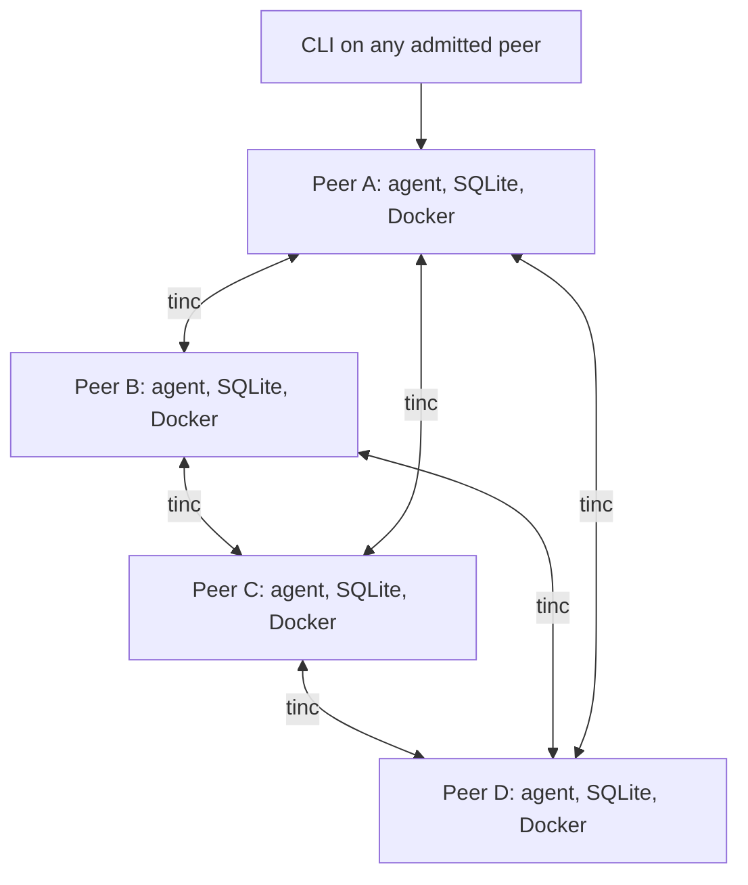

# RFC 001 — Matrix: a four-peer Byzantine-tolerant compute demo

**Status:** Proposed implementation contract  
**Date:** 31 October 2026  
**Delivery budget:** 12 hours  
**Scope:** Four fixed, team-operated Linux peers connected through tinc  
**Companion:** `Matrix_API_Contract.zip` contains `main.tsp`, its build configuration, and the generated OpenAPI contract.

This RFC supersedes the architecture and guarantees of the 12 October Campus Compute Exchange design for this demo. It specifies intended behavior, not an already implemented or measured system. MUST, SHOULD, and MAY are requirements, recommendations, and optional behavior respectively. Numerical defaults below are engineering choices, not measured performance claims.

## 1. Design decisions

### D1. Build a reliable compute demonstration before a marketplace

The release demonstrates approved CPU computation, peer communication, independently checked results, persistence, and recovery. Spendable credits, monthly allowances, campus login, and contribution payments are deferred. Contribution history is diagnostic only: a signature is not evidence of CPU time spent.

**Reason:** Balances, reservations, exclusive assignment, and globally ordered cancellation require shared-state agreement. Keeping those features would require a BFT state machine in addition to execution verification. They are not necessary to demonstrate the new challenge's central technical requirements.

### D2. Four fixed identities; tolerate one faulty identity

The only supported release configuration is `n = 4`, `f = 1`. All machines receive the same pinned membership/catalogue configuration. There is no runtime joining, automatic removal, or membership vote. Adding peers requires a new configuration and a new protocol review; this release MUST reject configurations with another population size. Four peers demonstrate arbitrary behavior by one peer; demonstrating two colluding admitted peers within a 25% bound would require an eight-peer extension with larger thresholds.

**Reason:** A fixed roster makes identity, thresholds, configuration distribution, and adversarial tests small enough to implement in 12 hours. A network address is not a voting identity. Repeated messages from one key count once.

### D3. tinc supplies connectivity; reachability is a deployment assumption

Use tinc on the hosts. The team supplies a network on which the four peers can establish the required paths, preferably a reachable LAN. Internet-wide NAT traversal, arbitrary campus Wi-Fi support, and automatic discovery are outside the release gate. No Headscale, cloud coordinator, DHT, or custom overlay is added.

**Reason:** The user has accepted limited reachability to prioritize a working demo. tinc is an existing transport dependency, not the project's correctness protocol.

### D4. Every peer runs the same application

Each peer runs one Python/FastAPI agent, one local SQLite database, an artifact directory, and a Docker supervisor. Each peer can submit, execute, collect, store, and recover jobs. There is no authoritative central backend, PostgreSQL instance, result server, scheduler, or mandatory web gateway.

**Reason:** Remove the special server role without building microservices. A temporary collector for a job has no exclusive authority; other peers can repeat its work.

### D5. Support one deterministic, side-effect-free CPU template

The mandatory template is `monte-carlo-v1`: a precisely specified integer implementation of a seeded Monte Carlo estimate of pi. Inputs are parameters in the immutable job; there are no uploaded datasets. Images are preloaded and identified by exact Docker image ID. GPU training, arbitrary images, shell commands, and user-supplied validators are excluded.

**Reason:** Exact result comparison is tractable for one reviewed workload. Pinned containers alone do not make arbitrary floating-point or GPU programs reproducible. Keeping the existing Docker approach is less work than introducing a new Wasm runtime.

### D6. A result needs two independent matching signatures

Request execution from three distinct roster members. Accept a result only when at least two distinct admitted peers have signed the same result for the same job and configuration. Contact the fourth peer if a target refuses, is unreachable, or collection has not produced a certificate after the expansion timer.

**Reason:** With at most one faulty identity, two matching signers include an honest executor. Three targets include at least two honest peers. Honest execution of the supported template has a single specified result.

This is a result-attestation protocol for pure computation. It is not general BFT consensus and does not provide a total order or exclusive ownership of shared state.

### D7. Allow duplicate execution; make observations local

Jobs are immutable and content-addressed. Multiple collectors and duplicate requests are allowed. Each peer deduplicates its own execution. Queued, running, stopped, and timed-out are local observations. A valid result certificate is durable evidence, regardless of which peer assembled it or which collector timed out.

**Reason:** Avoid distributed locks, authoritative leases, and leader election. Duplicate physical computation is an acceptable cost.

### D8. Persist evidence and require two storage acknowledgments

A job is **durably submitted** after two distinct peers acknowledge durable storage of the signed job. A result is **certified** after the execution threshold is met, and **durable** after two distinct peers acknowledge storage of the result and its valid certificate. These are different properties.

**Reason:** At most one of those holders is faulty. Reachability is still necessary to retrieve the surviving copy. Each new storage acknowledgment promises at least 24 hours of retention from issuance and carries a signed deadline. Do not implement eviction during the demo.

### D9. Keep the HTTP surface and signatures simple

Use HTTP over the tested tinc network for non-sensitive demo data. Every job, execution attestation, and storage acknowledgment has an Ed25519 signature over a precisely defined JSON payload. Reads are available to peers on the restricted interface. There are no cookies, shared bearer credentials, challenge logins, TLS certificate provisioning, or signed HTTP-request envelopes in this demo.

**Reason:** Immutable signed records provide the evidence needed for correctness and idempotent replay. This is an explicit deployment/security compromise: confidential data, Internet exposure, unrestricted denial-of-service resistance, and production transport hardening are not promised. End-to-end TLS can be added later without changing result certificates.

### D10. A CLI and logs are sufficient

The release interface is a CLI or equivalent small Python scripts. React, a global dashboard, account management, and automatic installation are stretch work only after the fault tests pass. FastAPI's generated documentation is useful for inspection, but it is not the primary submission flow because submissions must be signed.

## 2. Goals, assumptions, and guarantees

### 2.1 Release outcomes

1. Four admitted peer identities communicate through tinc.
2. At least two physical machines are used for the multi-machine execution demonstration. Four logical peers may use Linux VMs on those machines if needed; disclose the host mapping. Four independent physical hosts are preferred for a claim of tolerating any one physical host failure.
3. A requester obtains a correct certified result despite one peer returning a fabricated result or withholding work.
4. No permanent central application service is needed to submit or retrieve jobs.
5. Local owner controls and Docker limits work without contacting another peer.
6. Durable jobs and outputs survive one holder's failure within the retention assumptions.
7. A partition preserves result safety; sufficient connected honest executors can continue working.
8. A recovering peer learns and verifies missing evidence.

Four processes on one machine test protocol behavior, not independent host availability. A router, access point, power supply, or shared physical host may be a common failure domain; this RFC does not claim infrastructure fault independence.

### 2.2 Threat model

At most one of the four admitted peer identities is faulty during a configuration's demo/retention interval. That identity may lie, stall, replay records, equivocate, corrupt its own files, ignore local limits, or withhold data. A crash or owner stop may consume the same availability budget. More simultaneous unavailable peers may still permit progress, but that is not guaranteed by the fault bound.

Honest peers run the same template and verification rules, protect their private keys, and sign computation results only after independently executing the requested job. Secure signatures, collision-resistant SHA-256, correct honest software, finite admitted load, and eventually useful honest communication are assumed. Compromising different identities successively until more than one key is exposed is outside the model. Shared implementation bugs are also outside the Byzantine-replica guarantee.

### 2.3 Guarantee matrix

| Property | Promise | Condition / boundary |
| --- | --- | --- |
| Accepted-result safety | An honest verifier accepts only the specified template result | One faulty identity, honest deterministic execution, secure hashes/signatures |
| Conflicting outputs | Two different result values cannot both have valid execution certificates | Same job/configuration and the preceding assumptions |
| Progress | A valid job eventually certifies | Two honest executors receive it, have capacity, and can deliver evidence to a collector |
| Durable submission | At least one honest signed-job holder survives | Two valid storage acknowledgments and the fault/retention assumptions |
| Durable result | At least one honest holder retains output plus certificate | Two result-storage acknowledgments and the same assumptions |
| Partition safety | Thresholds and signature verification do not change | No automatic membership shrink or trust in peer-reported finality |
| Deadline | Local execution and collection waits are bounded | There is no universal completion deadline during a partition |

Correctness means execution of the specified program on specified inputs. It does not prove the application's scientific usefulness, private host behavior, or CPU/GPU work performed.

### 2.4 Explicit compromises

- Fixed roster, preloaded images, manual network setup, tested Linux environment.
- Pure CPU jobs; no GPU correctness promise or generic program execution.
- No credits, exclusive reservations, global cancellation, or exactly-once execution.
- No confidential workloads or open Internet API deployment.
- Architectural support for independent jobs, but no claim of linear useful-compute scaling as the global fault budget grows.

## 3. High-level design

### 3.1 Deployment



The diagram shows logical peer reachability, not guaranteed direct Internet tunnels. tinc may use forwarding. No node is a required collector or application authority. All peer APIs expose the same contract.

### 3.2 Components inside one peer

| Component | Responsibility |
| --- | --- |
| FastAPI | Schema validation and peer endpoints |
| Crypto module | Canonical JSON, SHA-256, Ed25519, membership checks |
| Job store | SQLite transactions and content-addressed result files |
| Executor | FIFO local queue, one active container, local timeout and stop |
| Collector | Request execution, merge attestations, build certificates, collect storage acknowledgments |
| Synchronizer | Poll the other three peers and ingest missing signed records |
| CLI | Sign submission, print evidence, inspect local status, control local execution |

One agent process runs these modules. Use a single background supervisor loop plus bounded asynchronous peer requests. Docker execution MUST NOT block the API event loop. No message broker or distributed task queue is needed.

### 3.3 End-to-end flow

1. CLI loads the trusted configuration, creates a nonce, constructs the job specification, computes its ID, and signs the job request.
2. The local agent persists the job and sends it to the other peers. It reports durable submission only after two verified storage acknowledgments, including its own if applicable.
3. The collector chooses three execution targets using the rule in section 5.3 and requests execution in parallel. A selected local peer is queued directly.
4. Honest executors validate, run Docker, persist canonical output, and sign an execution attestation.
5. Each executor announces its result plus its attestation to the other three peers. Receivers count distinct valid signers by result hash.
6. Any peer with two matching attestations builds a certificate. An executor signature and a storage acknowledgment are different types and MUST NOT be counted interchangeably.
7. The collector sends the certified package to all reachable peers. Two durable result-storage acknowledgments establish durable completion.
8. CLI verifies the evidence itself and prints the result, signers, and durability holders. It does not trust a server's `certified: true` flag.

Job manifests and result payloads are the actual peer-to-peer data path. The selected template has no external prepared input. A general dataset/artifact-upload API is not part of this release.

## 4. Network and configuration

### 4.1 tinc profile

- Run tinc on each host in router mode, with one dedicated VPN address per peer.
- Prefer the same installed build on every machine. Baseline: stable 1.0.37, subject to successful installation and connectivity preflight; record the actual package/build versions in demo evidence.
- Pre-distribute host keys and configure the other three peers as startup targets. Do not assume tinc 1.1 `AutoConnect` options exist in a 1.0 package.
- Use a non-conflicting private address range, for example `10.77.0.0/24`, with one `/32` advertised per peer. Validate `StrictSubnets = yes` against the chosen package.
- Bind the agent only to its VPN IP on TCP port 8443; the URL scheme for this demo is `http`.
- Firewall the VPN interface to allow the Matrix API and the traffic actually needed for diagnostics. Do not expose Docker, databases, SSH, host routes, or exit-node behavior.
- Do not place tinc inside a workload container. Do not bridge the VPN into the container network.

The legacy protocol has documented limitations; selecting a stable version is a build-time convenience, not a production security endorsement. Synthetic/public inputs and application signatures are mandatory. Switching to an all-SPTPS-capable tinc build is a separate tested deployment choice, not a prerequisite for writing the compute protocol.

### 4.2 Trusted configuration

The configuration includes `protocol_version`, `network_id`, exactly four peer records under `peers`, and the catalogue entry under `catalogue`. Each peer record contains `id`, `public_key_hex` (raw Ed25519 bytes), `vpn_ip`, and `api_url`. Peer IDs are `node_a`, `node_b`, `node_c`, and `node_d`; the peer array is sorted by ID. Every public key and address must be unique. tinc transport keys and application signing keys are separate. The companion TypeSpec defines `NetworkConfiguration`, `PeerConfiguration`, and `TemplateConfiguration` for these offline inputs.

The catalogue entry binds `template_id`, exact Docker `image_id`, `algorithm_id`, `cpu_limit`, `memory_mib`, `pids_limit`, `timeout_seconds`, and `output_schema_version`. Use `docker image inspect` to record the local `sha256:...` image ID after loading the same image archive on each machine. Do not invent an image digest or accept a mutable tag alone.

`config_hash = SHA256(C(NetworkConfiguration))`; the configuration object itself has no `config_hash` field. A job binds this hash. Endpoints fail closed on unknown configurations. The CLI prints the local hash; the operator compares all four before starting. No node receives authority merely because tinc learned its location.

### 4.3 Required preflight

All four configuration hashes and image IDs match; all peer APIs are reachable through VPN addresses; all machines can execute the fixture; the clock-independent result bytes match; signing keys never enter the container. If public-network reachability fails, use a tested LAN. Do not build NAT traversal during this delivery window.

## 5. Low-level design

### 5.1 Canonical encoding and signatures

Define `C(x)` as UTF-8 JSON with lexicographically sorted object keys, compact separators, `ensure_ascii=True`, and `allow_nan=False`. All protocol fields use ASCII strings, booleans, arrays, objects, and bounded integers. Floats, null, duplicate JSON keys, unknown properties, and booleans supplied as integers MUST be rejected. Arrays retain their order. Hashes are 64 lowercase hex characters; Ed25519 signatures are 128 lowercase hex characters.

Python's reference encoder is `json.dumps(x, sort_keys=True, separators=(",", ":"), ensure_ascii=True, allow_nan=False).encode("utf-8")`. Parse with duplicate-key rejection before schema validation. Pydantic models use strict integers and `extra="forbid"`. Do not hash model defaults that were absent from a request: every signed field is required.

Sign `C(payload)` directly. Domains inside signed payloads are mandatory:

| Signed object | Domain |
| --- | --- |
| Job request | `matrix.job.v1` |
| Execution attestation | `matrix.execution.v1` |
| Job-storage acknowledgment | `matrix.store-job.v1` |
| Result-storage acknowledgment | `matrix.store-result.v1` |

Ed25519 verification always uses the public key from the pinned configuration for the payload's signer. A public key supplied by an incoming message is never authoritative. Store private keys in owner-only host files. Replaying a valid immutable object is idempotent; this release does not need a signed-request timestamp or replay cache.

### 5.2 Job and result identities

`JobSpec` contains protocol version, config hash, requester ID, a 16-byte random nonce encoded as 32 lowercase hex characters, template ID, and parameters. `job_id = SHA256(C(JobSpec))`. The signed `JobRequest` contains its domain, `job_id`, and `spec`; the spec's requester is the signing identity. A human-readable label MAY exist in local CLI state but is not a signed protocol field.

The canonical result is `{schema_version: 1, samples: N, seed: S, hits: H}`. `result_hash = SHA256(C(result))`. An execution payload binds its domain, config hash, job ID, result hash, and signer ID. A result certificate is exactly two matching valid signed execution attestations sorted by signer ID. More evidence MAY be retained locally; any two distinct matching signers suffice. Different valid signer pairs for the same result are equivalent evidence, not conflicting decisions.

Job storage binds config hash, job ID, signer, and `retained_until_unix` (Unix seconds). Result storage additionally binds result hash. A result-storage acknowledgment means the holder has persisted the signed job, canonical result, and a valid certificate. It is not evidence that the holder executed the job. A holder may issue its own acknowledgment only after the durability steps in section 5.6. No wall-clock timestamp enters a computation result or its matching identity.

On issuing a storage receipt, persist a deadline at least `local_now + 86400` and then sign that deadline. Reissues may extend it; old still-valid receipts remain equivalent storage evidence through their own deadlines. Verify two distinct, unexpired receipts for the same object, assuming honest host clocks are within 5 seconds of real time. Display the minimum signed deadline of the selected pair minus a 5-second safety margin as `durable_until`. Do not present replayed expired receipts as current durability. Clock assumptions affect retention reporting only, not execution-result safety or signature thresholds.

### 5.3 Target selection and retries

Sort the four peer IDs. Rotate this list left by `int(job_id[0:8], 16) % 4`; take the first three as initial targets. This includes the submitting machine if selected. Self-execution is allowed because there are no credits; it counts once under that machine's roster key.

First persist the signed job at a remote target, then call its execute endpoint. A failed target does not change membership. On refusal/unreachability, try the fourth immediately. Otherwise request the fourth after 10 seconds without a certificate. If all targets are busy, retry with a 3-second delay. Duplicate execute requests return the existing local execution record. A stopped/failed local execution MAY be explicitly retried; it must still produce the same deterministic result before any signature is issued.

The collector has a 180-second local wait budget. Expiry returns `pending` and evidence collected so far, never a global failed/cancelled decision. `collect JOB_ID` resumes later. Known uncertified jobs are also serviced by the background recovery loop; collectors do not have ownership leases.

### 5.4 Exact workload definition

`algorithm_id = xorshift32-u16-quartercircle-v1`. Required parameters: `samples`, an integer from 100,000 through 10,000,000; `seed`, an integer from 0 through 4,294,967,295. Default CLI example: 1,000,000 samples, seed 42. No implicit defaults exist on the wire.

Reference pseudocode:

```python
MASK = 0xffffffff
R = 65535
state = seed if seed != 0 else 0x6d2b79f5
hits = 0

def next_u32():
    global state
    state = (state ^ ((state << 13) & MASK)) & MASK
    state = (state ^ (state >> 17)) & MASK
    state = (state ^ ((state << 5) & MASK)) & MASK
    return state

for _ in range(samples):
    x = next_u32() & 0xffff
    y = next_u32() & 0xffff
    if x*x + y*y <= R*R:
        hits += 1

result = {"schema_version": 1, "samples": samples, "seed": seed, "hits": hits}
```

Coordinates are nonnegative integers; the boundary uses `<=`. Arithmetic used for squared distances must not overflow 32 bits. Python integers satisfy this. The CLI may display `4 * hits / samples` for readability; this float is never signed or compared. Schema/range checks alone do not prove the hit count: the execution certificate does.

Reference-algorithm fixtures (not physical-container test results): 100,000 samples with seed 42 produces 78,706 hits; 100,000 samples with seed 0 produces 78,528 hits. The companion `protocol_vectors.json` includes exact canonical bytes, hashes, and signed test objects. Its deliberately public test keys and zero configuration hash MUST NOT be used as deployment identities/configuration.

### 5.5 Executor behavior

One active container per peer, FIFO queue of at most eight jobs. Docker baseline: 1 CPU, 256 MiB RAM, 64 PIDs, no network, non-root user, dropped capabilities, read-only root filesystem, bounded temporary space, one writable output directory, and no Docker socket, home mounts, devices, or application credentials. The approved image must be tested with those restrictions before it is enabled.

Use fixed argv generated by the approved template. Never accept a command or mount from a request; never run it through a shell. Labels bind `matrix.job_id` and `matrix.execution_id`. Runtime timeout is 120 seconds; log retention is 1 MiB per execution; output is at most 1 KiB of canonical result JSON. Stop the actual container, not just the Python launcher. Graceful stop gets 3 seconds, followed by force removal.

Only successful execution with the complete expected result schema produces an attestation. Timeouts, memory exhaustion, missing images, owner stops, and local exceptions produce diagnostic local states, never signed computation-failure claims. A peer MUST independently execute before signing; reading another peer's result does not make it an executor.

Before publishing, persist the result and the attestation. Never sign a second distinct result for the same job/configuration. If a rerun disagrees with a previously signed local result, stop signing and report `LOCAL_DETERMINISM_ERROR`.

### 5.6 Persistence and crash ordering

Use SQLite WAL mode with `synchronous=FULL`, foreign keys, and short transactions. A small local lock serializes conflicting job updates. No transaction remains open while Docker or network calls run.

Store canonical result bytes under `data/results/<result_hash>.json`. Verify the hash, write a temporary file, flush/fsync it, atomically rename it, and fsync the directory before committing the SQLite reference. Only then publish an execution attestation or storage acknowledgment. SQLite-record persistence precedes network acknowledgment. Ordinary honest fsync/storage semantics are assumed.

Minimum records:

| Record | Key / fields |
| --- | --- |
| jobs | `job_id` primary key, signed request JSON, admitted-at time, retention-until time |
| executions | unique `job_id`, execution ID, local state, container ID, last error, locally signed result hash |
| candidates | unique `(job_id, signer_id, result_hash)`, attestation JSON and result hash |
| certificates | `job_id` primary key, result hash, two-attestation certificate JSON |
| receipts | unique `(kind, job_id, result_hash-or-empty, signer_id)`, latest valid signed receipt JSON by retention deadline |

Keep at most two distinct candidate hashes per signer/job as equivocation evidence. Duplicate bytes are ignored. Equivocation is reported but does not automatically revoke membership or change thresholds. A conflicting valid certificate causes a visible invariant violation and halts certification for that job; it is not resolved by arrival order.

On restart, terminate leftover Matrix-labeled containers, mark interrupted local executions aborted, load persisted jobs/evidence, and resume collection. Re-execution is allowed only if needed; existing local signatures are reused. Never delete certified evidence on restart.

### 5.7 Certificate verification

Before counting a result:

1. Verify the signed job, requester membership, configuration, job hash, template, and parameter limits.
2. Strictly validate the result, including matching sample count and seed, and `0 <= hits <= samples`.
3. Recompute its canonical hash.
4. Verify every attestation's domain, configuration, job ID, result hash, membership, and Ed25519 signature.
5. Count distinct signer IDs only. Require two; reject certificates with repeated signers or mismatched hashes.
6. Persist the canonical result and certificate before issuing a result-storage acknowledgment.

An announcing peer's address, HTTP success, container report, or local-state flag contributes no vote. The CLI runs the same verifier before presenting success. Distinct valid certificates must agree on result hash under the threat assumptions.

### 5.8 Synchronization and collector recovery

Every 3 seconds, each peer polls the other three for their bounded job index. For unknown IDs, fetch and verify the signed job before storing it. For known jobs, fetch snapshots and ingest valid candidate announcements, certificates, and receipts. Never overwrite the local execution state with another peer's state.

For every known uncertified job, ensure requests have been made to the target set, subject to retry/backoff and local pause. A recovering collector may issue the same requests as another collector. For every certified job with fewer than two storage receipts, republish the certified package. Certificate recipients store the package before acknowledging it.

Snapshots include signed result announcements so one honest holder can relay signatures from other peers after their original sender disappears. The receiver verifies each embedded signature. The index and status are hints, not authoritative statements. Peer calls time out after 2 seconds and run concurrently with a maximum of three outbound calls per peer loop.

The run admits at most 32 jobs per peer and at most eight queued executions. The CLI/demo stays within these bounds. No eviction occurs to make room. Full queues return retryable errors. Unrestricted flooding and fairness against an abusive admitted peer are excluded.

### 5.9 Owner controls and lifecycle

CLI commands provide `submit`, `collect`, `inspect`, `pause`, `resume`, and `stop-local`. Signing uses the local peer key. `pause` atomically creates a local `paused` marker; `resume` removes it. `stop-local` creates the pause marker and an atomic stop-request marker consumed by the supervisor. These commands operate on host files; there is no remotely callable admin endpoint.

Pause rejects new local execution and leaves current work running. Stop terminates local work within the supervisor polling interval plus the 3-second grace period. Agent polling of control markers is once per second. It continues storing/serving evidence while paused. Controls do not revoke already issued signatures.

Local execution states: `none`, `queued`, `running`, `succeeded_local`, `aborted_local`, `error_local`. Certification and durability are independent derived properties. The CLI displays, for example, `certified; storage 1/2; local execution running`. Receiving a certificate may stop a redundant local execution, but this optimization is optional.

There is no global cancel endpoint. A requester may stop waiting or stop its own local execution; another partition can still complete the pure job. A paused peer remains a roster member and cannot be silently removed from threshold calculations.

## 6. TypeSpec and HTTP contract

The companion `main.tsp` is the wire-model/API source. Its emitted OpenAPI is a handoff aid for implementing Pydantic models and checking the FastAPI schema. Node.js and TypeSpec are development tools only; neither is required on compute peers. Cross-field invariants, signature semantics, exact two-signer rules, and strict unknown-property rejection are normative here even when they cannot be fully expressed by an OpenAPI schema.

Wire models are `JobSpec`, `JobRequest`, `SignedJob`, `MonteCarloResult`, `ExecutionAttestation`, `SignedAttestation`, `ResultAnnouncement`, `ResultCertificate`, `CertifiedResult`, `JobStorageReceipt`, `SignedJobReceipt`, `ResultStorageReceipt`, `SignedResultReceipt`, `Health`, `JobIndex`, `ExecutionAccepted`, `Ingested`, and `JobSnapshot`. A `CertifiedResult` contains the signed job, result, and certificate so that evidence is self-contained. A `ResultAnnouncement` contains one candidate result and one signed attestation. A snapshot may contain up to eight announcements and one certified package, plus up to four receipts of each kind.

All bodies are JSON; peers send no unsigned replacement keys. Every signed wrapper has `payload` and `signature` fields. Every configured key is a lowercase-hex raw 32-byte Ed25519 public key. Empty optional fields are omitted, never encoded as null. Server errors have `{code, message, retryable}` bodies with no stack traces.

| Method / path | Body / response | Behavior |
| --- | --- | --- |
| `GET /v1/health` | `Health` | Diagnostic peer ID, config hash, pause state, and local load |
| `GET /v1/jobs` | `JobIndex` | All known IDs, at most 32; no pagination in this release |
| `PUT /v1/jobs/{job_id}` | `SignedJob` -> `SignedJobReceipt` | Validate and durably store; return existing/reissued equivalent receipt on replay |
| `GET /v1/jobs/{job_id}` | `JobSnapshot` | Signed job, local state, bounded signed announcements, optional certified package, receipts |
| `POST /v1/jobs/{job_id}/execute` | No body -> `ExecutionAccepted` (202) | Queue once, or return existing record; 429 if unavailable/full |
| `POST /v1/jobs/{job_id}/results` | `ResultAnnouncement` -> `Ingested` | One result plus its signed attestation; verify and merge; may build a certificate |
| `POST /v1/jobs/{job_id}/certificates` | `CertifiedResult` -> `SignedResultReceipt` | Validate, persist complete package, then acknowledge storage |

Path IDs must equal payload IDs. Execute and result/certificate endpoints require an already validated stored job; otherwise return 404. The signed job inside a certified package must equal the stored signed job. It cannot replace that job. Execute requests cannot authorize a new program. Result/certificate senders may relay evidence, but all embedded signers are verified. Posting an identical object is safe. Concurrent imports are serialized locally. A fresh nonce creates a different job; recovery/retry preserves the original ID and signed bytes.

No separate binary-transfer API is required: bounded result JSON travels in announcements and certified packages. Logs remain local for this release. This keeps the actual MVP implementable while retaining genuine peer-to-peer result transfer.

Limits: signed-job body 16 KiB; result-announcement body 4 KiB; certified-package body 8 KiB; per-job snapshot 64 KiB; HTTP request absolute cap 16 KiB. A result's canonical JSON is at most 1 KiB. Index and snapshot sizes are bounded independently. Enforce bytes before JSON decoding.

| HTTP status | Example codes | Meaning |
| --- | --- | --- |
| 400 | `INVALID_SCHEMA`, `BAD_HASH`, `BAD_SIGNATURE`, `INVALID_CERTIFICATE` | Malformed or unverifiable record |
| 403 | `UNKNOWN_MEMBER`, `CONFIG_MISMATCH` | Not authorized under the pinned configuration |
| 404 | `UNKNOWN_JOB` | Store the signed job before retrying |
| 409 | `JOB_CONFLICT`, `INVARIANT_VIOLATION` | Incompatible object or violated safety invariant |
| 413 | `PAYLOAD_TOO_LARGE` | Reject before decoding/execution |
| 429 | `PAUSED`, `QUEUE_FULL`, `JOB_LIMIT` | Bounded capacity; no membership change |
| 503 | `IMAGE_UNAVAILABLE`, `LOCAL_STORAGE_ERROR` | Local prerequisite/storage unavailable |

## 7. Failure behavior

| Event | Required behavior |
| --- | --- |
| One peer returns plausible but wrong hits | Store validly signed candidate as untrusted evidence; one signer cannot certify it |
| One peer stalls | Two honest initial targets can complete if they can communicate; fourth target is a fallback |
| Peer replays its signature many times | Distinct-signer count stays one |
| Peer signs different results to different recipients | Preserve bounded equivocation evidence; no automatic exclusion |
| Collector disappears | Other peers discover the signed job, merge evidence, and collect independently |
| One storage holder disappears | Retrieve from another holder; re-replicate where possible |
| Docker crashes or exceeds local time limit | Local error only; no signed incorrect/failure result |
| Two-plus-two partition with an honest pair | That pair can execute and certify a job whose signed request they have; expansion/recovery may request both |
| Isolated honest peer | It cannot create a certificate alone; may serve existing certified evidence |
| Network heals | Verify and merge immutable records; do not choose a winning partition |
| Local collector budget expires | Return pending; later collect resumes |

No finite wall-clock progress promise applies during arbitrary partitions. Even within the one-fault bound, progress requires honest communication and capacity. tinc's routing is not itself Byzantine consensus; a malicious sole transit peer can harm availability.

## 8. Twelve-hour implementation plan

| Elapsed time | Deliverable | Exit check |
| --- | --- | --- |
| 0–1 h | tinc, roster, keys, image distribution | All four peer APIs and configuration hashes agree |
| 1–3 h | Exact workload, Docker supervisor, canonical models/signatures | Fixtures and canonical bytes match on physical workers |
| 3–5 h | Job store and seven HTTP operations | Submit, execute, and retrieve one signed result on another machine |
| 5–7 h | Collector, certificate verifier, storage receipts | Three executions; two signatures; two durable result holders |
| 7–9 h | Restart recovery, synchronization, owner controls | Kill collector, restart peer, pause/stop without central service |
| 9–11 h | Fault injection and partition tests | Acceptance matrix passes; failures remain visible |
| 11–12 h | Freeze, repeat demo, collect evidence | No new features; clean reproducible run |

If behind: remove cosmetic UI, cross-OS support, extra templates, direct/forwarded throughput visualization, and optional redundant-container cancellation. Do not remove signature verification, fixed membership checks, deterministic execution, durable-write ordering, or the two-signer threshold. If recovery or partition tests fail, disclose that limitation rather than describing them as implemented.

Suggested code layout: `agent/api.py`, `models.py`, `crypto.py`, `store.py`, `executor.py`, `collector.py`, `sync.py`; `cli.py`; `templates/monte_carlo/`; `tests/`. Use existing Python libraries: FastAPI/Pydantic, an HTTP client, SQLite, and Ed25519 from a maintained cryptographic library. The Docker CLI is sufficient; no container orchestration layer is needed.

## 9. Acceptance tests and demonstration

### 9.1 Automated checks

| ID | Check | Expected evidence |
| --- | --- | --- |
| T01 | Same spec signed/hashed on all peers | Exact matching canonical bytes and IDs |
| T02 | Alter job parameters after signing | Signature/hash rejection |
| T03 | Unknown key, wrong domain/configuration, mismatched path | Reject without execution |
| T04 | Duplicate JSON keys, boolean integer, unknown fields, oversized body | Reject before admission |
| T05 | One valid signature repeated twice | Invalid certificate |
| T06 | Two distinct matching signatures | Valid certificate |
| T07 | One correct and one wrong result | No certificate until a second correct signer appears |
| T08 | Replayed execution request | One queued/running local record |
| T09 | Concurrent result imports | Correct grouping and unique local certificate |
| T10 | Result corruption or crash before acknowledgment | Reject corruption; never acknowledge incomplete durable state |
| T11 | Restart after a local signature | Reuse signature or reproduce identical result; never sign a new hash |

### 9.2 Multi-machine checks

1. Normal run: submit at A; execute on three targets; show two execution signers and two storage holders.
2. Wrong-result run: enable a clearly labelled test-only fault on one peer; it signs an in-range fabricated hit count. Honest peers must certify the correct result.
3. Stall run: one peer withholds work/replies. The job still certifies when honest communication/capacity holds.
4. Equivocation run: one peer sends different signed hit counts to different recipients. Neither fabricated value certifies.
5. Collector-loss run: stop the original collector as the single injected fault after durable submission. Another peer resumes using the same job ID.
6. Storage-loss run: after durable completion, stop one result holder and retrieve/verify from a survivor.
7. Partition run: block all cross-group API communication for a true 2+2 split; an honest pair with the signed job can certify. An isolated peer cannot lower its threshold. Heal and synchronize.
8. Owner-control run: pause, resume, and stop locally while another peer is disconnected.

Reset fault modes between single-fault demonstrations. Killing a collector while a different peer is Byzantine is an additional fault and must not be presented as required by the one-fault model. Fault modes (`wrong-result`, `stall`, `equivocate`) use the faulty peer's own key, never an honest key, and are visibly labelled in logs. Partition tests must account for tinc forwarding: cutting one tunnel may leave another path.

Record actual peer/host mapping, package/image versions, config hash, signed job, canonical result, certificate, storage receipts, fault mode, and recovery outcome. Run-to-run times are measured evidence only; no predetermined speedup is claimed.

## 10. Scalability and deferred design

The implementation distributes independent jobs and has no permanent central application bottleneck, but it intentionally fixes the demo size. It does not automatically split arbitrary programs or pool GPUs.

For a future fixed roster of size `n` with global fault bound `f=floor(n/4)`, repeated deterministic execution needs at least `f+1` matching executor signatures, and `2f+1` targets to cover withholding by `f` selected peers. Keeping the threshold at two when expanding to eight peers is unsafe. Splitting into groups does not ensure each group inherits the global fault fraction.

Consequently, generic replicated execution has scaling costs. A future version can add application-specific cheap verification or carefully analysed committees. Global credit balances require a BFT ordered state machine. Internet-wide reachability, open admission, confidential computation, and GPU verification each require a separate decision rather than an implicit version-one promise.

## 11. Preflight values to fill before launch

These are operational inputs, not unresolved protocol choices: four host/VPN addresses and public keys; actual tinc build; Docker image ID and catalogue hash; writable data directories; verified firewall rules; and two reference workload fixtures. No fabricated image hash or untested physical-network claim belongs in the final demo record.

The protocol choices are fixed by this RFC. The team may proceed once those concrete deployment values pass preflight.

## 12. References

- Earlier project input: `Pasted text(20261031-070047).txt`, Campus Compute Exchange design dated 12 October 2026.
- [tinc connection model](https://www.tinc-vpn.org/documentation/How-connections-work.html): startup targets and symmetric peer roles.
- [tinc 1.1 connection model](https://www.tinc-vpn.org/documentation-1.1/How-connections-work.html): metadata paths, NAT traversal limits, and forwarding.
- [tinc configuration](https://www.tinc-vpn.org/documentation/Main-configuration-variables.html): router mode, ConnectTo, and StrictSubnets.
- [tinc release history](https://www.tinc-vpn.org/news/) and [security notes](https://www.tinc-vpn.org/security/): version/security tradeoff behind the deployment scope.
- [Docker resource constraints](https://docs.docker.com/engine/containers/resource_constraints/) and [security](https://docs.docker.com/engine/security/): execution controls inherited from the earlier design.
- [PyTorch reproducibility](https://github.com/pytorch/pytorch/blob/main/docs/source/notes/randomness.md): motivation for excluding heterogeneous GPU training from exact result matching.
- [TypeSpec HTTP operations](https://typespec.io/docs/libraries/http/operations/) and [installation](https://typespec.io/docs/): API contract format and build workflow.

External references describe dependencies. The protocol, thresholds, resource budgets, scope restrictions, and schedule are this RFC's design decisions. No physical implementation tests are claimed by publication of this document.
